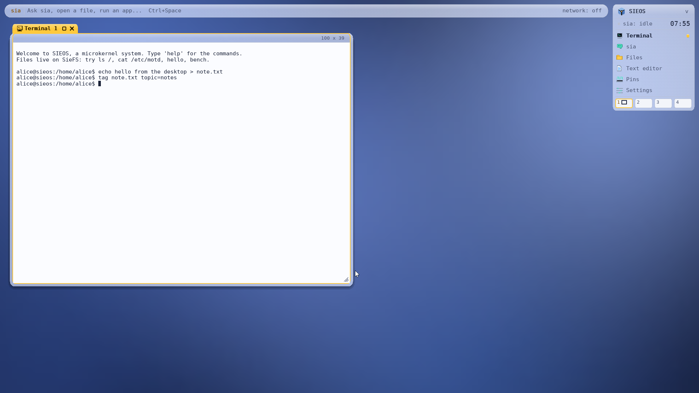
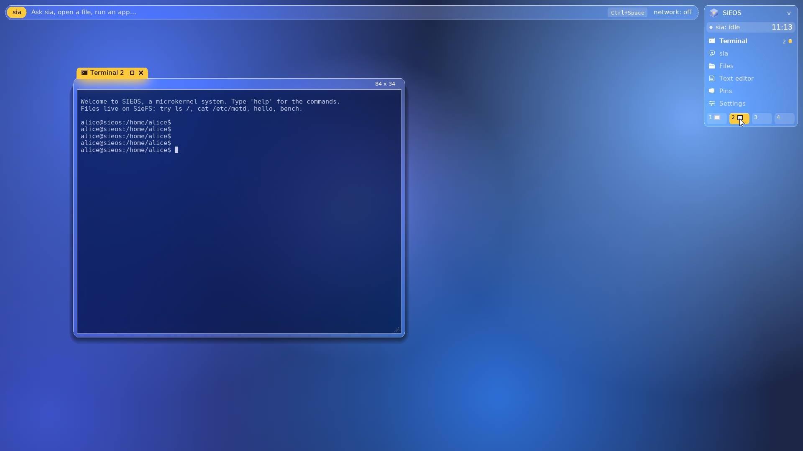
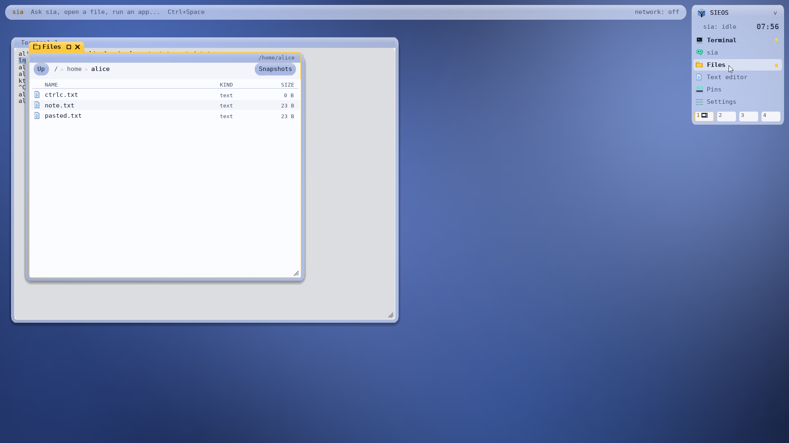
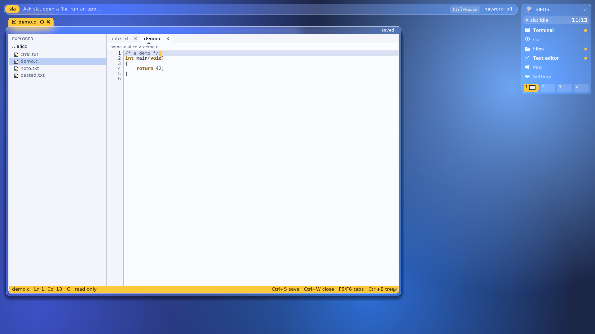
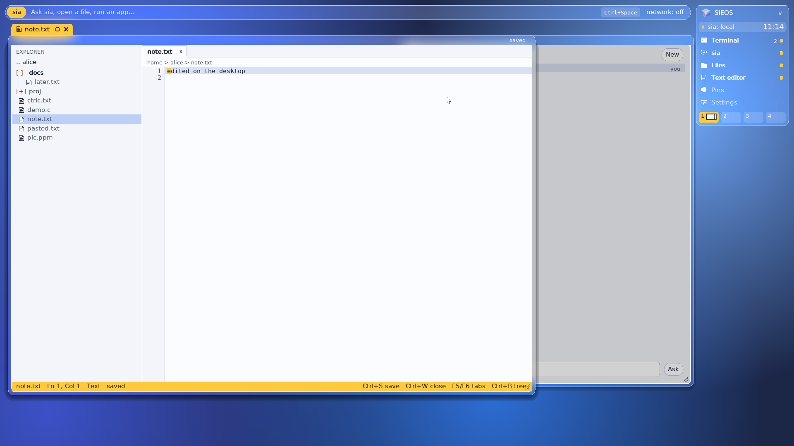
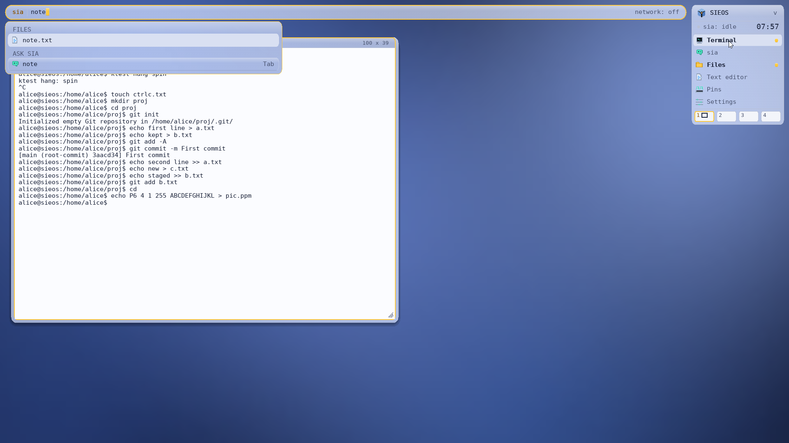
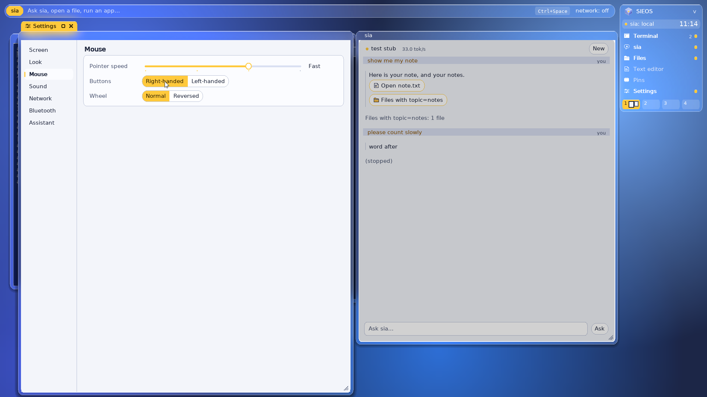
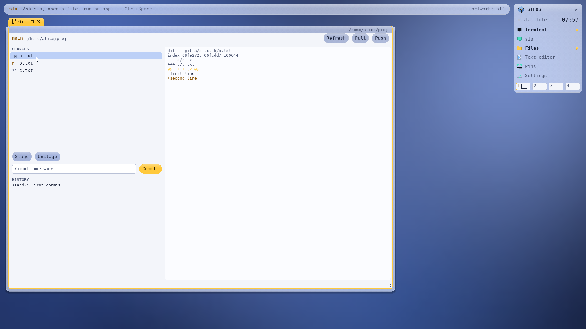
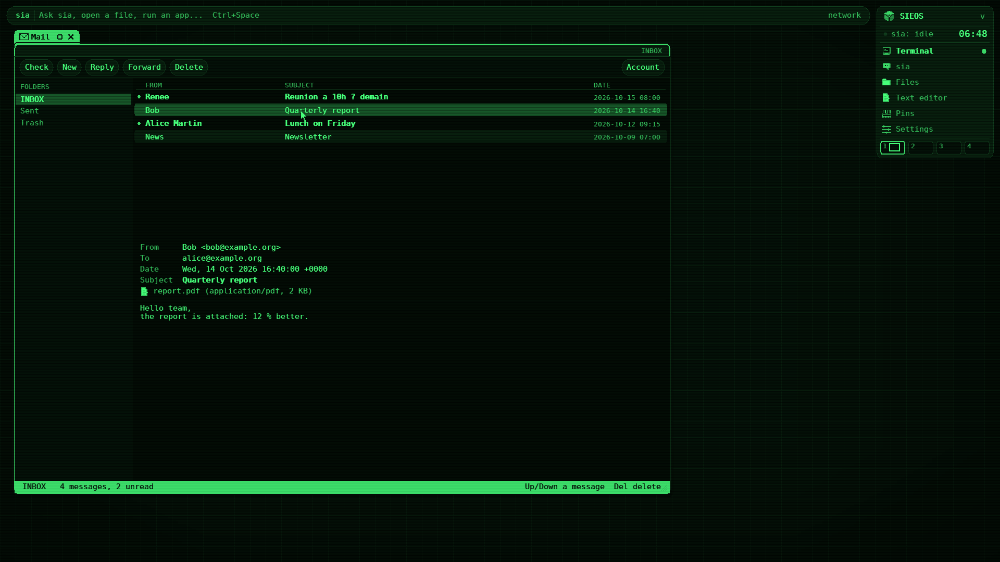
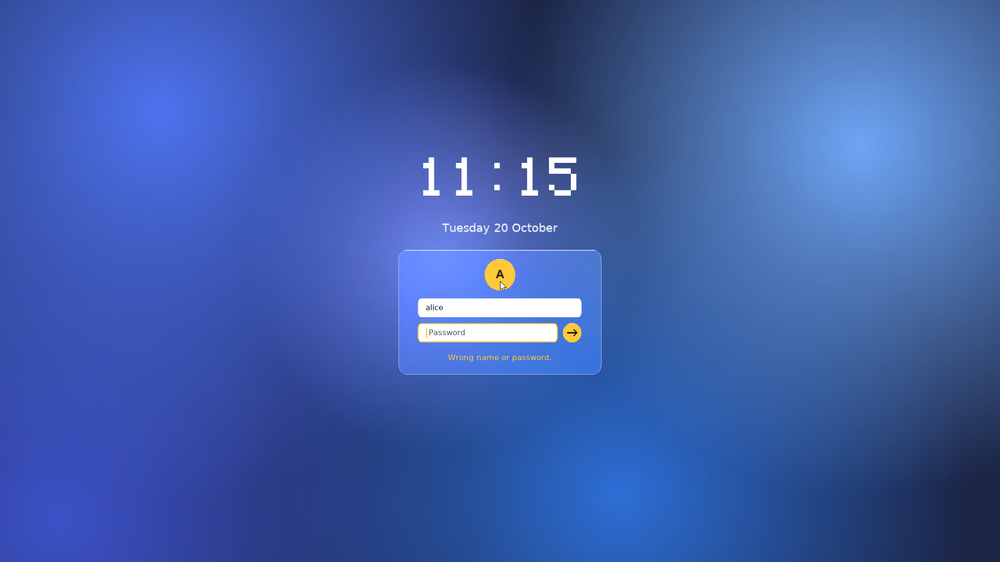

# The desktop

Part of SIEOS. (c) Olivier Moulin. SPDX-License-Identifier: GPL-3.0-only

The desktop (`user/atlas/`, the program `/bin/atlas`) is laid out as
BeOS's was, in SIEOS's own colours: windows with a **title tab** as wide
as their title, the **Deskbar** at the top right, **4 workspaces**, and
the **sia strip** at the top left to find a file, start an app or ask the
assistant. (It replaces the older "Stage" desktop of projects, a stage and
a shelf.)



```
 ┌─ sia │ Ask sia, open a file, run an app...      network ─┐ ┌─ (cube) SIEOS    v ─┐ the menu
 └──────────────────────────────────────────────────────────┘ │ sia: idle    11:38   │ tray
 ┌──────────────────────┐                                      │ Terminal           > │ apps (running:
 │ ▣ Terminal 1   □  x  │  the tab: icon, title, zoom, close   │ sia                  │ bold, with >)
 ├──────────────────────┴─────────┐                            │ Files                │
 │                                │                            │ Text editor          │
 │  a window (dark glass)         │                            │ Settings             │
 │                            ⟋⟋⟋ │  the grip: resize          │ [1] [2] [3] [4]      │ workspaces
 └────────────────────────────────┘                            └──────────────────────┘
```

## Windows

- **The tab** sits on the window's top left, as wide as its title: the
  app's icon (its outline), the title in bold, then zoom (a square) and
  close (a plain x) together at the right end. The
  focused window's tab **rises** out of its frame in the accent colour
  (220 ms, a slight overshoot); when another window takes the focus, it
  **sinks** back in (170 ms) and the title stays, dim, in the strip at
  the window's top (drag the strip to move a window that has no tab up).
  With the tab up, the strip's right side says more (a terminal's size,
  whether a file is saved, the folder in Files). A thread ticks every
  16 ms only while a tab moves; nothing redraws at rest. **x** closes,
  **□** zooms (the whole desk; again: back). The strip's right side is in
  the small size. Drag the tab to move the
  window; **double-click** it to minimize; right-click it for the window's
  menu: *Minimize*, *Zoom*, *Send to workspace N*, *Close*.
- **Opening:** a new window powers on like a CRT: a bright line at its
  middle that widens, then opens to its full height (160 ms, on the tabs'
  animation thread; not under Glass, nor at 300% and up, where a whole
  window each frame costs too much on a Pi).
- **Depth:** each window has a hard shadow down and to the right (two
  steps, a printed look rather than a blur) and a thin dark gap around its
  frame, so overlapping windows stay apart; the insides of every window
  but the focused one are dimmed to three quarters (not another
  program's: those are shown as the program drew them).
- **Resize** with the grip (bottom right) or any edge; the smallest is
  360 x 200. New windows go down and to the right of the front one, so
  every tab stays in view; sia opens on the right. Each kind opens at a
  size for what it shows: Files narrower and shorter than a terminal,
  Pins about 60% of the desk's height, Settings about half its width.
- **Past the screen's edges:** a window may be moved (or resized) past
  the bottom, the right or the left side; only its tab must stay wholly
  on the screen. Past the left side the tab slides along to stay in view.
- **Minimized** windows come back from the Deskbar (their app's row, or
  the menu, where they are marked "(hidden)").
- **Workspaces:** each window lives on one of 4; the Deskbar's cells or
  Ctrl+1..4 switch, *Send to workspace* moves a window. Bringing a window
  back (from the Deskbar or its menu) goes to its workspace.



What a window can be:

- **Terminals.** Each one is a shell started by `auth` **as you** (never
  as root), with its own console, `atlas#N`: the client library sends the
  shell's console requests to atlas, the window's number in `w[3]`. The
  terminal takes the size of its window, up to 132 x 60 characters, with
  500 lines of history (66 KiB per terminal, given back when it closes).
  Drag across the text to select it: it is copied at once.
- **The editor**, laid out like a code editor. Started on its own (the
  Deskbar, the menu, an editor app), it opens on an empty **untitled**
  tab, the tree at your home folder: nothing is asked until you save.
  Ctrl+S on it asks for a name and saves it in the folder last clicked in
  the tree, shown in bold (at first the tree's top, your home folder; a
  click on `..` makes the folder above it the one); a file opened while
  that tab is still empty takes its place. The tree is read again each
  time the editor opens this way, so new folders show. On the left, the
  **Explorer**: the tree of your files, from your home folder (`..` shows
  the folder above); a click opens or closes a folder (`[+]` / `[-]`) or
  opens a file. On the right, the open files as **tabs** (up to 10): a
  click shows one, its `x` closes it; a changed file's tab shows a small
  square instead, and closing it asks a second click. Under the tabs, the
  file's path; then the text with line numbers, the cursor's line lit, a
  block cursor, and colours for C (and the like), shell and Python, and
  Markdown (keywords bright and bold, comments dim). At the bottom, an
  inverse status bar: the file, line and column, its kind, saved or
  changed. Files up to 64 KiB (bigger or binary files, or files you may
  not change: read only). Keys: arrows, Home/End, Page Up/Down,
  Backspace, Del, Enter, Tab; Ctrl+S saves; Ctrl+W or Esc closes the tab;
  F5 / F6 the tab before / after; Ctrl+B hides or shows the tree. The
  last tab closed closes the window.
- **Files** (`files.c`). A folder's contents under a header (*Name*,
  *Kind*, *Size*), one row each (icon, name, what it is by its name: C
  source, text, app..., size), folders first and in bold, every other row
  tinted; it starts in your home folder. Double-click (or Enter): a folder
  opens in place, a file in the editor, a launcher (`.app`) starts. *Up*
  (or Backspace) goes to the parent folder; the path beside it is a link
  a part at a time (`/ > home > alice`: a click on `home` goes there). An
  empty folder says so in the middle. Only what you may read is shown.
  *Snapshots* (at the right) opens the hidden `.snapshots` folder of the
  volume you are in ([siefs.md](siefs.md#snapshots)): one folder per
  snapshot, the hourly `auto-...` ones and those taken with `snap`, with
  everything as it was then, read only (a file opens in the editor read
  only); `snap restore NAME` takes the whole volume back to one.
- **The assistant** (`panel.c`). A conversation with `sia`, shown as it is
  written: your questions on a lighter band marked *you*, sia's answers
  beside a line in the gutter, the model at the top after a dot (lit when
  it runs) with its speed in the small size. A thread of atlas does all the talking (`SIA_OPEN`, `SIA_ASK`,
  then `SIA_NEXT` piece after piece), so the desktop never waits. sia
  starts when you ask. *New* forgets the conversation, *Ask* (or Enter)
  asks, *Stop* (or Esc) ends an answer. When sia offers to remember
  something, a *Remember: ...* button keeps it (sia's memory). Answers may
  carry actions, each on a line of its own, shown as outlined buttons
  with an icon (a file, a folder, sia for *Remember*):
  - `[fly:PATH]`: open that file (a path's end, like `note.txt`, is
    enough);
  - `[island:KEY=VALUE]`: list the files with that attribute under the
    sia strip.

  The first question of a conversation tells the model these conventions
  and lists your files.
- **Pins** (`pins.c`): the Raspberry Pi's GPIO pins as the tracks of a
  sequencer: outputs play their patterns, inputs record their level at
  each step (simulated pins elsewhere). Every step is numbered (the
  beats, 1, 5, 9..., brighter) and the playhead lights its column. See
  [gpio.md](gpio.md).
- **Git** (`repo.c`, the Git app): a repository's changes, diffs and
  history; [below](#git).
- **Settings** (`settings.c`): below.
- **Mail** (`mail.c`, the app *Mail*): [below](#mail).







## The Deskbar

- **The menu** (the SIEOS cube): Terminal, sia, Files, Text editor,
  Settings; the apps of `/etc/apps`; every open window (minimized ones
  "(hidden)"); *Log out*.
- **The tray:** sia's state (idle, local, online) after a dot, lit while
  sia runs, and the clock in the title size. On a laptop, the battery left of the
  clock (its outline filled as charged; accent while charging, red under
  15%; the % in Settings and `battery`); the menu then has Sleep, and Settings a Power section (the
  lid closed: screen off, or sleep). See [power.md](power.md).
- **The apps:** Terminal, sia, Files, Text editor, Pins, Settings. A running
  one is in bold with a lit dot (Terminal: and how many, from 2): a click
  brings its window back in front (the terminal used last, for Terminal);
  otherwise a click starts it. Right-click: *New ...* and its windows.
- **The workspaces**, 1 to 4, each a small map of its windows (where they
  are on the desk, the front one brighter): the current one outlined in
  the accent colour.

Right-click the desk itself for a menu to start things, and *Log out*.
A workspace with no window shows the time, large and dim, at the desk's
bottom right, and the keys to start with under it (redrawn each minute
with the Deskbar's clock).

## The sia strip

Click it or press Ctrl+Space, then type a few letters: the results drop
down under it, grouped: **Files** (by name, in your home folder), **Apps**
(your `.app` launchers and those of `/etc/apps`), and **Ask sia**. Enter
opens the first result, Tab asks sia, Esc closes the results. Text
starting with `?` only offers the question; a `mailto:` link opens Mail,
writing to it. Typing when no window has the keys goes to the strip too.



## Keys

| Keys | What they do |
|---|---|
| Ctrl+Space (or Ctrl+F) | the sia strip |
| Ctrl+T | a new terminal |
| Ctrl+W | close the window in focus (the editor: its tab) |
| Ctrl+Tab | the next window of this workspace, in front |
| Ctrl+1 .. Ctrl+4 | a workspace |
| Ctrl+S | save (editor) |
| Ctrl+N, Ctrl+R, Ctrl+Shift+R, Ctrl+L, F5, Ctrl+Enter | Mail: new, reply, reply all, forward, check, send |
| Ctrl+V, middle button | paste (terminal, editor, assistant, strip, Settings) |
| Ctrl+C (terminal) | stop the program running there (SIGINT); closing the window hangs it up (SIGHUP) |
| PgUp / PgDn, the wheel | a terminal's history |
| Esc | back: closes the strip's results, a menu or a name box; in the editor, closes the tab (twice if not saved); in the assistant, stops an answer |

Mouse events carry no modifier keys: everything is reachable with clicks,
right-clicks and the keys above.

## Settings

*Settings* (the Deskbar, its menu, or the strip: "settings") is a window
of the desktop, on every machine. Its sections have titles in the title
size; each choice is a segmented control, its options joined (the chosen
one filled), wrapped onto more rows when the window is narrow:

| Section | What | Kept in |
|---|---|---|
| Screen | the size: 1280 x 720, 1366 x 768, 1600 x 900, 1920 x 1080, 2560 x 1440 where the screen can take any (QEMU's VGA and ramfb, the Pi 4, whose firmware scales the picture to the monitor, the laptop's Intel display, which also offers its panel's own size and the panel's **brightness**). It changes at once and **goes back by itself after 15 s** unless you press *Keep*, so a monitor that cannot show it is never a dead end. A firmware's fixed screen (UEFI, the Pi 5) shows its size. | `/etc/display.conf` (the login screen too) |
| Look | **Phosphor** (the default: a green monitor, with scanlines and glowing text), **Amber 1984** (amber, square corners, a grid of dots), **Glass** (the desktop's own colours) or **BeOS** (BeOS R5's colours: the blue desk, grey windows and panels, the yellow tab, black text, white fields and lists); the **size** of everything: 50%, 75%, 100%, 125%, 150%, 200%, 300%, 400% | `~/.look`, applied at your login (the login screen: Phosphor, 100%) |
| Mouse | pointer speed (Slow, Normal, Fast, Faster), right- or left-handed buttons, the wheel normal or reversed | `~/.mouse`, applied at your login |
| Sound | the volume: Mute, 25%, 50%, 75%, 100%; the output (Speakers or a monitor with sound, shown when there is one) ([audio.md](audio.md)) | the audio server, until a reboot |
| Keyboard | shown only where the USB server drives a keyboard light (the Legion's, [usb-stack.md](usb-stack.md#the-keyboard-light)): Off, Low, High, and a colour (White, Red, Orange, Green, Cyan, Blue, Purple; a colour picked while off turns it on) | `/etc/kblight`, given to the keyboard at each start |
| Network | Wi-Fi (the Raspberry Pis' CYW43455): the connection's state, **Scan** for networks in range, pick one, type the passphrase (WPA2) and **Join**, or **Forget**. A system setting: root's password is asked unless root is logged in. Where there is no Wi-Fi chip (every machine but a real Pi, QEMU included) it shows "No Wi-Fi on this machine." | `/etc/wifi.conf` (root only) |
| Assistant | sia's model: the one on this computer, or **online**, any service with an OpenAI-compatible API (server URL, model name, API key). A system setting: root's password is asked unless root is logged in. | `/etc/sia.conf`, the key in `/etc/sia.key` (root only) |

The speed is applied by the console server (`CON_MOUSE`: how far a mouse
count moves the pointer, for this screen's size), the buttons and wheel by
the desktop. Root's password is checked by `auth` (`AUTH_CHECK`). A
running sia restarts with the new model settings.

The Network section talks to the Wi-Fi server (`wifid`, port `wifi`,
[net.md](net.md)); it shows its controls only when that server is running,
so a machine without a Wi-Fi chip shows "No Wi-Fi on this machine." and the
desktop never waits for a server that will not come. *Scan* and *Join*
block the desktop for the few seconds the chip takes.

The looks are made where the picture reaches the screen (`draw.c`): the
desktop draws in its own colours, and each pixel goes out as its
brightness in the look's colour (a 256-entry table; a darker table for
the scanline rows, every third row in Phosphor, every fourth in Amber).
The scanlines **bloom**, as a CRT's beam spot grows with its intensity:
the brighter a pixel, the less its scanline row darkens it (Phosphor:
black loses 45%, full brightness almost nothing; Amber: 30% to nothing),
so lines show on the dark desk and in dim text, while filled buttons and
the focused tab stay solid and readable.
Text glows: a dim halo beside each stroke. The desk itself darkens
towards its corners, as a curved tube does (a vignette on the grid's
pixels only: windows are untouched). Amber also squares the
corners and draws the grid as dots. Nothing else in the desktop knows
about looks, so icons, terminals and new windows follow by themselves.

**Other programs' insides keep their own colours.** A look is atlas's
own: its frames, tabs, strip, Deskbar, pointer and built-in windows
(terminals, Files, Settings...). The insides of another program's window
(a web page, a document) go to the screen exactly as the program drew
them, in every look: no tint, no scanlines, no glow, no dimming
(`dl_client` in `draw.c` marks those strip pixels with bit 24, which no
colour uses, and the look's table is skipped for them: one test per
pixel, no measurable cost per frame). A shadow or a dimmed backdrop
falling on them darkens them without tinting them. A program that wants
the look follows it itself (the toolkit's theme, [ui.md](ui.md));
`make ui-test` checks every pixel of exact colour patches
(`tests/ui/uipatch.c`) in all four looks, and that the frame around them
has the look's colours.

BeOS changes the colours themselves rather than how they reach the
screen: the desktop draws in a **palette** (`pal[]` in `draw.c`; the
`C_...` names in `atlas.h` are its entries, by role: the desk, a panel,
an edge, the accent, text, text on the accent, the accent as text, where
you type...). Phosphor, Amber and Glass share the dark palette; BeOS has
its own (and corners of at most 3 pixels), shown as drawn, like Glass.
Phosphor costs about 30% more per full frame than Glass (5.5 ms instead
of 4.2 ms at 1920 x 1080 under QEMU on x86-64).

The size works the same way, in `draw.c`: the desktop lays out a picture
of the screen's size divided by the zoom (at 100%, 0.75 screen pixels per
picture pixel: 2560 x 1440 on a 1920 x 1080 screen; at 200%, 1280 x 720),
and every item is scaled as it is added: boxes, corners, lines (never
thinner than a pixel), text and icons. So it is drawn sharp, not
stretched, and the rest of the desktop does not know. Text comes in
**three sizes** (`atlas.h`): titles (`ST`: Settings' sections, the
Deskbar's clock), the body (`S(2)`) and small text (`SS`: the strip's
right side, sizes in Files, the editor's Explorer heading and path). At
100% each is a **native font** rendered once from DejaVu Sans Mono by
`tools/mkfont15.py` and drawn pixel for pixel: 11 x 20 (`font18.c`),
9 x 16 (`font15.c`) and 8 x 15 (`font13.c`); at other sizes the 6 x 11
pixel font is scaled, each screen pixel taking the share of the font's
pixels it covers (smooth edges, even strokes). The pointer is never
zoomed: when it moves, its old and new places are redrawn at its own
size on the screen (`present_pointer`), so it leaves no trail.
The pointer's position comes as a fraction of the screen, so clicks land
at any size. Windows keep their place and size in proportion to the desk
when the size (or the screen's) changes.



## Git

The Git app (`/etc/apps/git.app`, kind `git`; the strip finds it as
"git") opens a window on a repository: the Files window's folder if it is
in one (open the folder in Files, then the app), else the last one opened
(kept in `~/.gitrepo`), else the first folder of your home that holds one.

- The top: the branch, the folder, **Refresh**, **Pull**, **Push**.
- **Changes**, as `git status -s` shows them (`M ` staged, ` M` not yet,
  `??` new); a click shows the file's diff on the right (the staged one
  when it has only that).
- **Stage** / **Unstage** the chosen file (`git add`, `git reset`).
- A message field and **Commit** (Enter in the field commits too).
- **History**: `git log --oneline` (40 commits).
- Below: what the last action said; its whole output is on the right.

The window does not link git's code: it runs `/bin/git -C DIR ...` as you,
one command at a time, with a channel of atlas as its console, and reads
what it prints ([git.md](git.md)); when it ends (atlas reaps it), the next
one starts and the window is drawn again. That costs atlas 8.7 KB, where
linking git would have cost over 60 KB plus the network and TLS library.
git cannot ask for a password there: for HTTPS remotes that want one, set
`git config credential.token TOKEN` first.



## Apps

An app is a small text file of our own format, ending in `.app`:

```
# A SIEOS app launcher (docs/desktop.md): key=value lines.
name=Hello
run=/bin/hello
args=from an app
kind=terminal
```

| Key | Meaning |
|---|---|
| `name` | what the strip and the menus show |
| `run` | the program (absolute path) |
| `args` | its arguments (one line) |
| `kind` | `terminal`: runs in a new terminal; `editor`: opens the editor on an empty, untitled file; `settings`: opens Settings; `git`: the Git window; `mail`: opens Mail; `camera`: the Camera window; `install`: the Install window ([install.md](install.md)); `window`: a program that opens its own window (the web browser): its terminal waits minimized |

- Everyone's apps are in `/etc/apps`: Shell, Assistant chat, Text editor,
  Settings, Mail, Camera, Services, Hello, Fetch a web page, Disk benchmark, Git,
  Install; the add-on packages bring theirs: Web, Python, Scriptures
  ([packages.md](packages.md), [scriptures.md](scriptures.md)). Yours are
  any `.app` file in your home folder (the strip and Files find them).
- Starting an app opens a terminal **as you**; its shell runs the app's
  command when it first asks for a line. When the app ends, the shell
  stays (`exit` closes it).

## Other programs' windows

A program may draw a window of its own (`include/mk/atlas.h`): it asks
atlas for one (`ATLAS_WIN_OPEN`), draws its insides into shared memory in
the screen's own pixels, says what changed (`ATLAS_WIN_DAMAGE`, answered
once on the screen) and waits for what the window gets: keys, the pointer
and its wheel, a new size, focus, the close box. Atlas frames it like its
own windows (tab, workspaces, zoom, minimize) and shows its insides in
their own colours whatever the look; at most 8 at once; only the
user logged in may open one. The web browser (`/bin/web`,
[webkit-plan.md](webkit-plan.md)) is the first, Scriptures
([scriptures.md](scriptures.md)) the first written in SIEOS's own C;
`tests/web/atlaswin.c` the smallest.

Such a window gets the keys of the window it is: the desktop keeps
Ctrl+Space, Ctrl+T, Ctrl+W, Ctrl+Tab and Ctrl+1..4, and gives it Ctrl+F,
Ctrl+V, Ctrl+Enter and Ctrl+Shift+letter (as Mail gets them). The
clipboard is the program's too: `ATLAS_WIN_CLIP_GET` reads it (a
terminal's selection, or what a program put there), `ATLAS_WIN_CLIP_SET`
sets it (up to 16 KiB). A new size (`ATW_SIZE`) says the desktop's zoom
in its code (100: normal), so a program can size its text the same.
`ATLAS_WIN_THEME` gives the desktop's theme (its palette as the look shows
it, the look, the zoom, how round corners are, the text's size) and
`ATW_THEME` tells every window when the user changes it: the UI toolkit
([ui.md](ui.md)) draws its widgets with it, so a program's buttons and
menus follow the look while its content keeps its own colours.

## Mail

*Mail* (the menu, or "mail" in the strip) reads mail with **IMAP** or
**POP3** and sends it with **SMTP**, always over TLS (1.3, or 1.2 for
servers that know no better, as many mail providers) with the
certificate checked against `/etc/ssl/roots`, or pinned (below).



- **The accounts**, asked the first time (and with *Account*, or a click
  on an account's name in the folders): pick one at the top, or *New
  account*; *Remove* removes the one shown. Each has your name, address,
  how mail comes (IMAP or POP3; for POP3, *Leave on server*, yes by
  default; for IMAP, *Copy to Sent*, yes by default), the incoming and
  outgoing servers and ports, user name (the address if empty), password
  and *Accept a self-signed certificate* (no by default). Kept in
  `~/.mail` (key=value lines, a line `[account]` before each account
  after the first, so a file of one account is as it always was; mode
  600, in your home, which is encrypted). Ports 993 (IMAP), 995 (POP3)
  and 465 (SMTP) speak TLS at once; others (143, 110, 587) start in clear
  and must switch to TLS (STARTTLS, STLS) before the password is sent, or
  nothing is sent.
- **Self-signed certificates** (a server at home): with the option on, a
  certificate no authority signed is shown, by its SHA-256, in a band
  over the status line; *Accept* pins it (`in_pin`, `out_pin`: the
  incoming and the outgoing server each) and from then on that
  certificate only is taken from that server, whatever its name or date,
  and any other is refused ("the server's certificate changed"). Turning
  the option off forgets the pins. The server must still prove it holds
  the certificate's key, as always.
- **The window:** the buttons (*Check*, *New*, *Reply*, *Reply all*,
  *Forward*, *Delete*, *Account*); on the left, the favorite folders,
  then each account's (IMAP's LIST; POP3: INBOX), with their unread
  messages (IMAP STATUS); the `*` at a folder's right makes it a favorite
  or not (kept in `~/.mail`, `fav=` lines); the newest 300 messages of
  the folder clicked (from, subject, date; newest first; unread ones bold,
  with a dot); under them the message clicked: From, To, Cc, Date,
  Subject, the attachments (a click saves one into `~/Downloads`, decoded,
  numbered `1-name` if the name is taken), and the text wrapped to the
  window (the wheel or PgUp/PgDn scrolls it). Opening a message marks it
  read.
- **The text:** the text/plain part of a MIME message (else its HTML,
  tags stripped), quoted-printable and base64 decoded, Latin-1 made
  UTF-8, encoded words (`=?UTF-8?B?...?=`) in the headers decoded. The
  desktop's font is ASCII: accents are dropped, other characters show as
  `?` (`mail read` on a terminal shows the UTF-8).
- **Writing:** *New*, *Reply* (to the sender, or its Reply-To; "Re:", the
  text quoted with `>`, `In-Reply-To` and `References`), *Reply all*
  (also the others of To and Cc, in Cc, but none of your addresses),
  *Forward* (the text under a "Forwarded message" header, and its
  attachments); *From* (with several accounts: the one it goes from; the
  folder's by default); To, Cc (addresses separated by commas), Subject
  and the text; Tab goes to the next field; *Attach* opens Files: a
  double-click on a file attaches it (a click on its name, under Subject,
  takes it off); *Send*. The message goes out as UTF-8 text (with files:
  multipart/mixed, each file base64) with Date and Message-ID, CRLF lines,
  and lines starting with a dot doubled. A copy goes into the account's
  Sent folder (IMAP APPEND; the folder flagged `\Sent`, else one named
  Sent, Sent Items, Sent Mail or Sent Messages) unless *Copy to Sent* is
  off.
- **Delete:** IMAP: into the Trash (the folder flagged `\Trash`, else one
  named Trash, Deleted Items, Deleted Messages or Bin: COPY, then
  `\Deleted` and EXPUNGE); in the Trash (or with none), for good. POP3:
  the copy here and the server's (DELE).
- **mailto: links**: typed in the sia strip (`mailto:bob@example.org?subject=Hi`
  and Enter), Mail opens writing to that address, the link's subject,
  Cc and body filled in; `mail mailto:...` on a terminal does the same
  there (the text typed, a line with one `.` sends it).
- **Keys:** Up/Down the message before / after, Del delete, F5 check,
  Ctrl+N new, Ctrl+R reply, Ctrl+Shift+R reply all, Ctrl+L forward;
  writing: Ctrl+Enter send, Esc cancel (also the account form).
- **POP3** keeps the messages in `~/Mail/INBOX` (another account's in
  `~/Mail/INBOX-N`), one file each named by the server's UIDL, so none is
  fetched twice; read ones carry the attribute `seen=1`. With *Leave on
  server* off, each is deleted from the server once it is here. Messages
  over 8 MiB are left on the server.

The window does no networking itself. It starts **`/bin/mail -S`** as
you, on the console `atlas#1000`, and talks to it like a terminal does:
each command is the answer to the helper's `CON_READ` (one line, words
separated by tabs, the account first: `-a 1`), and its answer comes back
with `CON_WRITE`, ending in a line of one `\x1e` byte. So the desktop
never waits for a server, atlas does not link TLS (the window is 31
KB of atlas, instead of about 90 KB with the protocols and TLS), and what
comes from the network is parsed by a process of yours, not by the
desktop, which runs as root. The helper keeps one IMAP connection per
account between commands (a changed account connects again) and is
ended when the window closes or you log out. Attachments are saved, and
files attached are read, by the helper, as you.

```
   atlas (Mail window) ──"-a 0  list  INBOX"──► mail -S (as you) ──IMAP / POP3 / SMTP, TLS──► servers
                       ◄──lines, then \x1e──┘
```

The same program is a command, on a terminal (`-a N` first: the Nth
account, from 0; the first by default):

| Command | What it does |
|---|---|
| `mail` / `mail list [FOLDER]` | the newest 300 messages: id, `*` if unread, date, from, subject (tab-separated) |
| `mail folders` | the folders and their unread messages (tab-separated) |
| `mail read ID [FOLDER]` | a message as text (and marked read) |
| `mail save ID [FOLDER [N [DIR]]]` | its attachments (or the Nth) into `~/Downloads` (or DIR) |
| `mail delete ID [FOLDER]` | into the Trash; from the Trash, for good |
| `mail send FILE` | a draft: `To:`, `Cc:`, `Subject:`, `Attach:` (a file, one a line) lines, a blank line, the text |
| `mail mailto:URL` | a message to the link's address: the text typed, then sent |

## Camera

*Camera* (the menu, or "camera" in the strip; `/etc/apps/camera.app`)
shows the USB camera's live picture, fitted to the window (its shape
kept), and **Snapshot** saves it as `~/Pictures/camera-N.ppm` (the first
free number; P6: a short header, then RGB bytes), yours. A .ppm opened
from Files or the strip shows in the same window; **Live** goes back to
the camera. Without a camera it says "No camera."; with one another
program uses, "The camera is in use."

The window's thread asks the USB server for frames (port `camera`,
[usb-stack.md](usb-stack.md#cameras): 640 x 480, already 0x00RRGGBB) into
a back buffer, then tells atlas, which swaps the buffers and draws only
the picture's box before answering, so a frame is never shown half
written. The picture is a display-list item of its own (`dl_image`: each
screen pixel takes the nearest image pixel, through the look like
everything else of atlas's own; another program's window is the same item,
marked to bypass the look). Closing the window closes the camera, which powers
down. atlas: +6.4 KB of code.

## How it works

One process does the whole desktop, supervised by init like every server.
That keeps it small: no display server, no window pictures copied
between processes.

```
   con ──input events (CON_INPUT)──► atlas ◄── CON_WRITE / CON_READ to "atlas#N" ── sh
   (keyboard, mouse)                   │  ├── AUTH_LOGIN ──► auth ── starts ──► sh (as you)
                                       │  └── SIA_ASK / SIA_NEXT (its own thread) ──► sia
                                       └── draws ──► video memory
```

| File | What it does |
|---|---|
| `atlas.c` | the session: terminals, the Deskbar, the sia strip, menus, input, login |
| `wm.c` | the windows: tabs, boxes, moving and resizing, the stacking order, workspaces |
| `files.c`, `edit.c`, `panel.c`, `settings.c`, `mail.c` | the windows' insides: Files, the editor, sia, Settings, Mail |
| `icons.c` | the icons (12 x 12 pixel maps; their outline alone on a tab) and the SIEOS cube (16 x 16) |
| `setup.c` | the first start on the screen (the accounts) |
| `draw.c`, `font.c`, `font13.c`, `font15.c`, `font18.c`, `screen.c`, `igfx.c` | drawing (and the looks), the fonts, the screen (and the laptop's Intel display) |

- **The screen** (`screen.c`): x86, QEMU's standard VGA card or the UEFI
  firmware's screen (GOP); on the target laptop's Intel display (Raptor
  Lake-S / Alder Lake-S, PCI 8086:a788, display version 12) and on the
  second laptop's (Ice Lake "Iris Plus", 8086:8a52 and kin, display
  version 11) `igfx.c` sets
  the display up itself: the eDP panel and up to two DP or HDMI monitors,
  each in its best mode the link and CDCLK can carry (EDID over DP AUX or
  GMBUS, the VBT from the ACPI OpRegion for ports and the panel's power
  sequence and backlight), all showing the same picture, any size up to
  the firmware's, fitted by each pipe's scaler; the panel's brightness in
  Settings; a monitor with speakers gets its sound turned on (HDMI mode,
  the ELD for the HDMI codec: [audio.md](audio.md#hdmi-and-displayport)).
  **Ice Lake** differs in a few places, each a branch or a small table in
  the same code: the panel runs on the eDP transcoder (DDI A works from
  no other), DP_TP_CTL is per port, DPLL 0 and 1 have their own CFGCR
  registers, CDCLK's voltage goes to level 2 at most, one pipe alone gets
  one DBUF slice (i915's ICL table), its combo PHYs have their own swing
  table, and the monitor ports are DDI B (a combo PHY, DPLL 1) and the
  Type-C ports C-F (the Thunderbolt 3 / USB-C ports). A Type-C port is
  found by its live state: a legacy connector (the PCH's pin), DP
  alternate mode or Thunderbolt (the FIA's `DFLEXDPSP`). For legacy and
  DP-alt, the display takes the PHY from the USB side (`DFLEXDPCSSS`, once
  `DFLEXDPPMS` says it is ready), learns its DP lanes and pin assignment
  (one, two or four lanes: a USB-C dock that also carries USB 3 gives
  two), tells the FIA the lanes used, and drives the port's MG PHY: its
  MG PLL (i915's `icl_calc_mg_pll_state`), `MG_DP_MODE` and the MG swing
  tables. A Thunderbolt monitor (a DP tunnel the Thunderbolt controller's
  firmware sets up) uses the TBT PLL, shared by all such monitors, with
  its AUX channel switched to the TBT side; no PHY is programmed.
  **Hot-plug:** a thread of Atlas reads the hot-plug pins (the PCH's
  SDEISR: TC1-TC4 on Raptor Lake, DDI B and the legacy Type-C connectors
  on Ice Lake; and on Ice Lake the FIA's live states, one bit per port)
  twice a second; a change that still holds
  200 ms later (not a bounce) makes Atlas go over the monitor ports: one
  plugged in is probed and lit as at the start (EDID, mode, the next free
  pipe, B or C; sound if it has speakers) in a mode the CDCLK carries as
  it is, since changing CDCLK would blank the panel; one unplugged has its
  pipe, port, DPLL, IO power and sound turned off (and an Ice Lake Type-C
  PHY given back to the USB side). The panel is never
  touched but for its DBUF share: the shares follow i915's table for the
  pipes now running (Raptor Lake: the panel alone, both slices; with one
  monitor, half; with two, a quarter. Ice Lake: one slice alone or with one
  monitor, a quarter with two), each pipe moved at its next frame and only once its
  new blocks are free, so no two pipes ever share blocks. A third monitor
  finds no pipe (logged). DP "short pulses" (a sink asking for link
  retraining) are not handled: unplug and plug again. Each step is logged
  (`port 3: monitor plugged in`, `pipe A: DBUF blocks 1024-2047`, `pipe B
  on: ...`, `pipe B off`) to the console and `/etc/igfx.log`; past 12 KB
  the older hot-plug lines are dropped (the start's are kept).
  The picture stays in the firmware's frame buffer (already in
  the GGTT; cached RAM would need flushing for the display engine). It logs
  registers, modes and link training to the console and `/etc/igfx.log`
  (on Linux: `sudo build/host/siefs /dev/sdX2 cat /etc/igfx.log`); anything
  it cannot do leaves the firmware's screen, and a modeset that never
  finished makes the next start keep it (remove the log to try again).
  Not tested on either laptop yet. AArch64, QEMU's ramfb on `virt`, the
  firmware's framebuffer on the Pi 4, `simple-framebuffer` on the Pi 5.
  The layout is computed from the screen's size; below 1600 pixels wide
  the Deskbar is narrower.
- **Drawing** (`draw.c`): a display list (rectangles with round corners,
  outlines, text, small pixel images for the icons, and shades that darken
  what is under them, for shadows) turned into pixels 16
  rows at a time in a 120 KiB strip, each finished strip copied to video
  memory. No second full-screen image, and only the region that changed
  is redrawn: the pointer's two small squares, a terminal's window, a
  moved window's old and new place, the clock's corner. Windows wholly
  hidden behind another are not drawn.
- **The font** (`tools/mkfont.py` -> `font.c`): drawn for SIEOS, 6 x 11
  pixels a cell, shown twice as large (12 x 22) on the desktop; bold is
  the text drawn twice, a pixel apart.
- **Nothing runs when nothing happens:** no animation, no timer except
  the clock thread, which sleeps until the next minute (and, on the Intel
  display only, the hot-plug thread: one register read twice a second). Atlas looks at the
  files again when a terminal's shell asks for its next line (a command
  has just run), so a new file shows at once, with no polling.
- **Login:** the login screen first (the password goes to `auth`, which
  starts your first shell, in a window); on a new disk, the welcome
  screen creates the accounts first (`user/atlas/setup.c`,
  [accounts.md](accounts.md)).
- **Rights:** atlas runs as root (it owns the screen and starts your
  shells through `auth`), so before it reads a file or a folder, makes a
  file or starts an app, it checks the rights of the user logged in.
  Files it makes (new files, `~/.mouse`) are given to that user.
- **If atlas crashes** (or is killed), init starts it again within a few
  milliseconds: the login screen comes back and the old session's shells
  end. If con crashes, atlas takes the keyboard and mouse again as soon as
  the new con is up.



## Measurements

QEMU, x86-64 with KVM, 4 CPUs, 1920 x 1080 (`make gui-test`); AArch64
`virt`, emulated (`make ARCH=arm64 gui-test`).

| | x86-64 | AArch64 (emulated) |
|---|---|---|
| a full frame (whole screen), median over the test | 9.8 ms (max 24 ms) | 18.6 ms (max 40 ms) |
| the login screen, a full frame | 4.1 ms | |
| idle | no work: the clock thread wakes once a minute | same |

A full frame now draws every window of the workspace, back to front, so
it costs more when several overlap (the test ends with five windows
open); the Stage desktop showed at most two (4.1 ms). Most pictures are
partial (a terminal's window, a menu, the pointer), far cheaper.

## Tests

`make gui-test` (x86-64, gcc) and `make ARCH=arm64 gui-test` (AArch64,
sicc) drive QEMU through its control socket: the first start on the
screen; a file made by the user's shell; a second terminal (checked to run
as the user, uid 1000) moved by its tab and resized by its grip, moved
past the bottom right and the left side (its tab still on the screen), zoomed
and back, minimized by a double-click on its tab and brought back by the
Deskbar, sent to workspace 2 from its tab's menu, closed by its close box;
history, copy and paste (the pasted command runs); Files (a double-click
opens a file in the editor, which saves it; a second file from the
editor's tree in a second tab, tabs shown and closed; Up; the path's / part); Git (a
repository made in the user's terminal, chosen in Files: its 3 changes, a
diff, two files staged, a commit made as the user, Push refused without a
remote); the sia strip (a file, an
app, Esc, a question to the stand-in sia; the answer's buttons; Stop);
Camera ("No camera." under QEMU; a .ppm made in the terminal, opened from
the strip, its pixels checked on the screen);
Settings: pointer speed and left-handed buttons (kept in `~/.mouse`), the
looks (Amber 1984, Glass, Phosphor again: checked on the screen's pixels,
scanlines included; kept in `~/.look`), everything at 200% and back (a
click lands at both), the
screen at 1600 x 900 (kept), 1366 x 768 then *Go back*, 1920 x 1080
again, sia online (a wrong root password refused) and local again; atlas
killed and restarted by init; the console server killed. With
`/tmp/atlas.debug` present (the test makes it), atlas logs where it drew
the tabs, boxes, Deskbar rows, workspaces, files and Settings' controls,
and the time of each full frame; nothing is logged without it. `make
gui-test-real` does the same with the real sia and a model on the test
disk.

`make igfx-test` (on the host; part of `audio-test`): QEMU has no Intel
GPU, so `igfx.c`'s hot-plug runs against a fake display engine (power
wells, DPLLs, transcoders, DDI buffers, pcode, the hot-plug pins, DP AUX
and GMBUS answered as the hardware does) and two real monitors' EDIDs (a
Dell U2718Q on DP, a Samsung C24F390 on HDMI): a DP monitor plugged in, an
HDMI one on a DP++ port that does not answer at first, both at once, a
third with no pipe left, one unplugged, the other port given a DP monitor
again, everything unplugged; each time the pipes, DPLLs, sound and DBUF
shares are checked, and that no two running pipes ever share DBUF blocks
and no write changes the panel's pipe, port or clocks. Then the same
engine as an Ice Lake: the Dell in DP-alt mode on a Type-C port (its MG
PLL, `DDI_CLK_SEL`, the FIA's lanes and PHY ownership, `MG_DP_MODE`), the
Samsung on DDI B (DPLL 1), the Type-C monitor unplugged (the PHY given
back), two Thunderbolt monitors sharing the TBT PLL (on until the last is
unplugged), and a DP-alt port with only two DP lanes (the Dell at a mode
two lanes carry).

`make mail-test` (both architectures; 75 s on x86-64) runs Mail against
two servers of `tools/mailserver.py` on the host (IMAP, POP3 and SMTP over
TLS): the first with a certificate from a test CA made by openssl for the
run and added to the test disk's `/etc/ssl/roots` only, at 10.0.2.100; the
second, self-signed, at 10.0.2.101 (QEMU's `guestfwd`). The account form;
the folders' unread counts; INBOX's four seeded messages (quoted-printable,
base64 multipart with an attachment, encoded-word subject and sender, HTML
only) in order, unread ones counted; one read (`\Seen` on the server), its
attachment saved; a reply and a new message checked byte for byte on the
host (CRLF, the doubled dot, Date, Message-ID, In-Reply-To, the
recipients), the reply's copy in Sent (APPEND); a reply all (the others in
Cc, not us); a file attached from Files and a forward with its attachment,
compared with the original bytes; a mailto: link from the strip; delete
into the Trash, then from it for good; a favorite folder; `mail list`,
`read`, `folders`, `mail mailto:` on the console; a second account: its
self-signed certificate refused, then shown (the SHA-256 compared with
openssl's), accepted and pinned for both servers, its folders found by
name, a message sent from it (its copy in "Sent Messages"), a changed
certificate refused; POP3 in the window (list, read, delete, nothing
fetched twice); POP3 with STLS and *Leave on server* off, SMTP on 465, IMAP
with STARTTLS and a wrong password from the command line.
