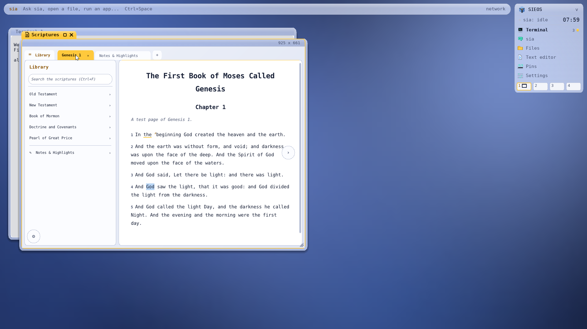

# Scriptures

Part of SIEOS. (c) Olivier Moulin. SPDX-License-Identifier: GPL-3.0-only

`/bin/scriptures` reads the scriptures from churchofjesuschrist.org
offline: footnotes, full-text search, highlights, notes and tags, several
chapters open at once in tabs, and notes synced with a Church Account
(Gospel Library). It is the **Scriptures** app (`/etc/apps/scriptures.app`,
in the sia strip and the Deskbar's menu), a window of the desktop's own
kind, drawn in the desktop's colours (glass's, as a window shows them). With its fonts it
is 941 KiB, so it is an add-on package ([packages.md](packages.md)):
`make pkg-scriptures`, then `pkg install scriptures.pkg`, or
`make usb PKGS=scriptures`.



The app is the user's own project (`/data/code/lds_scripture`, C and SDL2
on Linux), written with SIEOS in mind: a portable core, and the parts a
system must give it behind three small interfaces. SIEOS keeps the core's
files as they are and adds its own parts.

## Using it

The first start shows an empty library: **Download...** (or ⚙, bottom
left: Library) picks the language and the volumes; the standard works are
about 1,600 pages and take a few minutes. The library lives in
`~/.scriptures` (in the encrypted home: chapters as the content API's
JSON, a text search index, `notes.json`, `settings.txt`, the session).

Everything in the README of the app works the same, with these keys:

| Key | What it does |
|---|---|
| Ctrl+F | search (the desktop gives Ctrl+F to the window; Ctrl+Space still opens the sia strip) |
| Ctrl+Shift+N | every note, in a tab |
| Ctrl+L | show or hide the library |
| Ctrl+5 .. Ctrl+9 | tab 5 .. 9 (Ctrl+1 .. 4 are the desktop's workspaces) |
| ← → | the previous and next chapter; ↑ ↓ PgUp PgDn Home End scroll |
| Ctrl+C | copy the selection, with its reference (to the desktop's clipboard) |
| Ctrl+V | paste in a field (the desktop's clipboard: what a terminal selection copied) |
| Ctrl+W | close the window (the desktop's; the tabs come back at the next start) |
| middle button | open a chapter, a result, a note or a link in a new tab (what Ctrl+click does on Linux) |

The desktop sends no Alt and no Ctrl with a click, and keeps Ctrl+T and
Ctrl+Tab: use the tab bar's **+** and its tabs, the reader's ← Back and
the ‹ › arrows instead. Text size: ⚙ → Look.

## Church Account

⚙ → Church Account works as on Linux, through the clipboard: copy the
`cookie` header of a signed-in `annotations` request (the app's steps) on
another computer into a file, show it in a SIEOS terminal (`cat`), select
it (the selection is copied, up to 16 KiB), then **Paste & Connect**. The
session is kept in `~/.scriptures/account` (mode 600). **Open the
Sign-In Page** opens SIEOS's web browser when it is installed
(`make web-disk`); its developer tools are not there to copy a cookie
from. Firefox's session cannot be read (there is no Firefox).

## How it is built

```
user/scriptures/
  util json html store layout   the upstream core, unchanged (C11, integers in drawing)
  draw ui library app panels
  notesview  *.h
  font_tt.c + stb_truetype.h    upstream's, with SIEOS's font paths and two additions (below)
  plat_sieos.c                  the window (plat.h): an atlas window; input; clipboard; the start
  net_sieos.c                   HTTPS (net.h): user/lib/http.c and tls.c
  libc.c, include/              the C library the core asks for, on SIEOS's library
  debug_sieos.c                 the test's eyes (below)
  scriptures.mk                 the build, the fonts, scriptures-test
```

- **The window** (`plat_sieos.c`) uses atlas's protocol for other programs'
  windows ([desktop.md](desktop.md#other-programs-windows),
  `include/mk/atlas.h`): the app draws its whole picture into shared
  memory, says it changed (`ATLAS_WIN_DAMAGE`, answered once on the
  screen), and a thread waits for the window's events and queues them as
  the app's (`ev_t`); `plat_wait` sleeps on a futex until an event, a
  download thread's wake-up or the timeout. Keys arrive as characters with
  Ctrl applied, or `KEY_...`: Ctrl+letter becomes the letter with Ctrl,
  `KEY_CSA` Ctrl+Shift+letter; a printable key gives the key and its text,
  as SDL does. Double and triple clicks are counted here (400 ms, 4
  pixels). The desktop's zoom comes with each new size (`ATW_SIZE`'s code)
  and sets the app's scale. The app's `main` runs on a thread with a
  4 MiB stack (a program's own is 32 KiB); other threads get 1 MiB.
- **HTTPS** (`net_sieos.c`): SIEOS's HTTP/1.1 client and TLS 1.3/1.2, the
  certificates checked against `/etc/ssl/roots`. The app's headers (a
  browser's User-Agent, `Accept: application/json`, the Cookie with its
  Origin and Referer) replace http.c's own. A file `~/.scriptures/site`
  holding an address (`https://10.0.2.2:8443`) replaces the Church's site
  for every request: a mirror, or the test's server.
- **The C library** (`libc.c`, `include/_libc.h`, each standard header
  the same file): files and directories on the file server (a `FILE`
  reads a whole file at `fopen`, as the core only reads with it), the
  clock in UTC (SIEOS has no time zones yet: notes show UTC dates),
  threads and futex mutexes, `qsort` (stable), `sscanf`'s `%d` and `%s`, a
  little maths; formatting and number parsing are `/bin/cc`'s (`cc/libc/fmt.c`,
  exact, with floating point).
- **Fonts**: DejaVu Sans Mono and its bold (673 KB) in `/lib/fonts`, from
  the DejaVu 2.37 release the web browser's build already fetches (pinned,
  checksum checked); stb_truetype renders them at any size. The oblique
  face is the regular one slanted by 1/5 (253 KB saved), and ☰, which the
  mono face lacks, is drawn when no font has it. With the web browser
  installed, DejaVu Sans (in `/lib/fonts` too) gives the other symbols.
  Chinese, Japanese and Korean have no font on SIEOS yet: those language
  names show as boxes.
- **Left out**: importing the earlier Python version's library and reading
  Firefox's session (both through SQLite: Linux only), the mouse pointer's
  shapes (the desktop has one pointer), resizing the window from the app,
  gzip-compressed answers (the content API's JSON comes plain).

Built by the Makefile's compiler (gcc on x86-64, sicc on AArch64) with
floating point (`-mgeneral-regs-only` dropped, as for `/bin/python`: the
font rasterizer and JSON numbers). The desktop's side, for every program
with a window: Ctrl+F, Ctrl+V, Ctrl+Enter and Ctrl+Shift+letter reach the
window; `ATLAS_WIN_CLIP_GET` / `ATLAS_WIN_CLIP_SET` read and set the
clipboard (16 KiB, was 4); `ATW_SIZE` carries the zoom. http.c builds its
request on the heap (a Cookie of a few KiB fits; threads may request at
once) and leaves out its own User-Agent or Accept when the caller gives one.

Upstream: the core's files are those of `/data/code/lds_scripture/src`
dated 2026-10-17 14:17 (that folder has no version control; SHA-256 of
`sha256sum util.c json.c html.c store.c layout.c draw.c ui.c library.c
app.c panels.c notesview.c font_tt.c *.h` piped into `sha256sum`:
`ffcdbd90...a1f97df4`, font_tt.c before SIEOS's changes). To take a newer
version: copy those files again, then reapply font_tt.c's parts marked
"SIEOS".

## Sizes

| | x86-64 (gcc) | AArch64 (sicc) |
|---|---|---|
| `/bin/scriptures` (text) | 251 KB | 312 KB |
| of which the SIEOS parts (plat, net, libc, debug; cc's fmt.c) | 16 + 13 KB | 18 + 13 KB |
| fonts in `/lib/fonts` | 673 KB | 673 KB |

About 0.95 MB more in the image. At run time: the window's pixels
(4 bytes a pixel, shared with atlas), the app's picture of the same size,
the glyph cache, a 4 MiB stack and 1 MiB per download thread (4 while
downloading). The full English library on disk is ~73 MB.

## Tests

`make scriptures-test` (`tools/scripturestest.py`; ~45 s on x86-64, ~90 s on
emulated AArch64 with `SIEOS_SLOW=4`): the
first start, then Scriptures from the sia strip; its library from a
stand-in for the content API on the host (`tests/scriptures/server.py`:
HTTPS with a test CA added to the test disk's roots; Genesis 1-2 and
John 1 from the King James Version and made-up pages for the other
volumes). The empty library drawn in the desktop's colours -> Settings,
Library: the five standard works downloaded -> a book, a chapter -> a
footnote and its link -> a search (Ctrl+F, "light": 5 verses) and a result
-> a highlight (a double-clicked word, a colour) -> a note (its title and
text typed) -> the notes tab -> the window closed with Ctrl+W, notes.json
read in alice's shell -> Scriptures again: its tabs, the highlight and the
note back. Screenshots in `build/screens-scriptures/`.

The test reads the serial port on a thread of its own: the frames are many
lines, and a full pipe would stop QEMU, its control socket too. The test sees what the app drew through `debug_sieos.c`: when
`~/.scriptures/debug` exists, each frame shown is described on the log
(the serial port): the app's state, every zone a click can reach (found
with the core's `zone_at`), where the first words of the verses are. The
test clicks there.

Untested: the real churchofjesuschrist.org (its content API and its
certificate chain from SIEOS), the Church Account's sync (the notes
service is not a public API; the upload is experimental upstream too),
real hardware.
