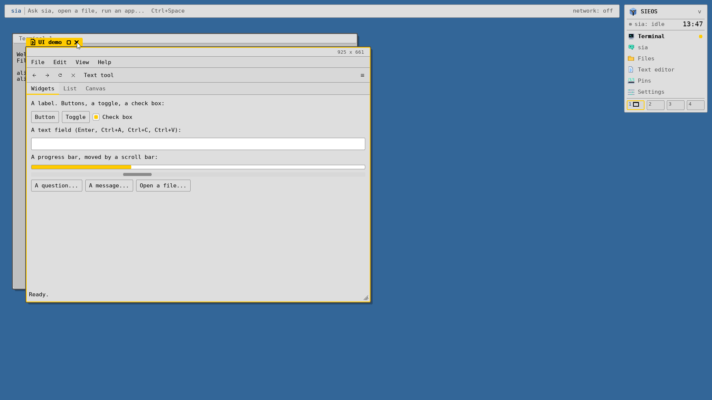
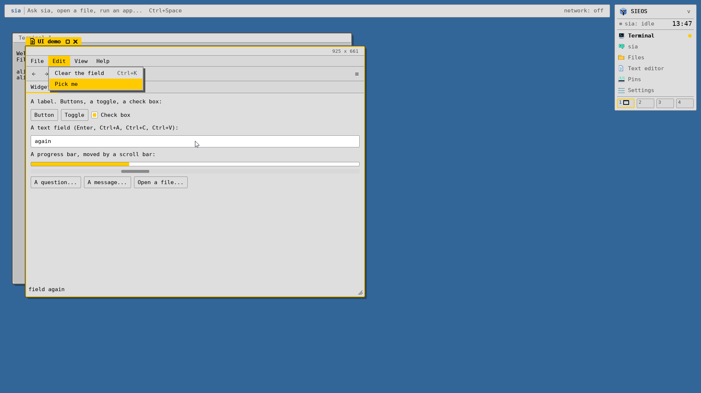
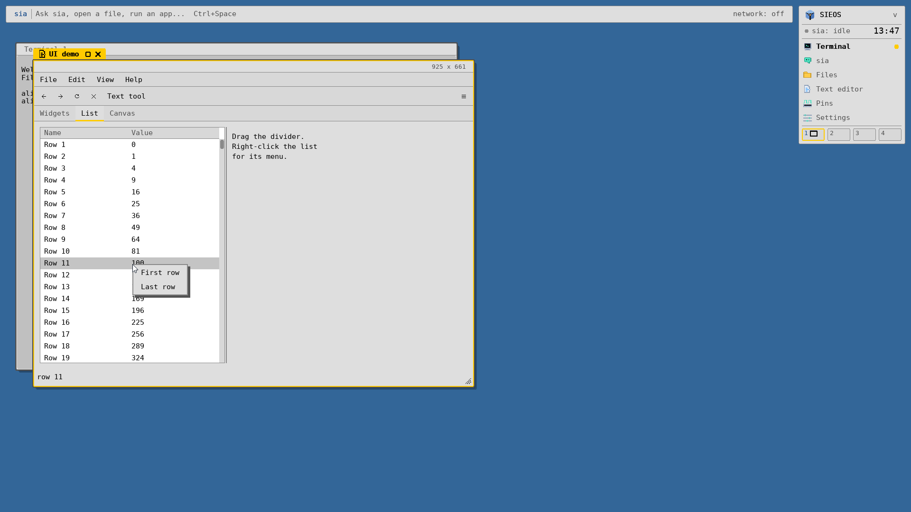
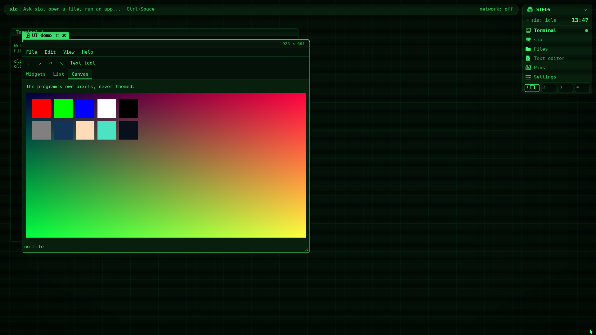
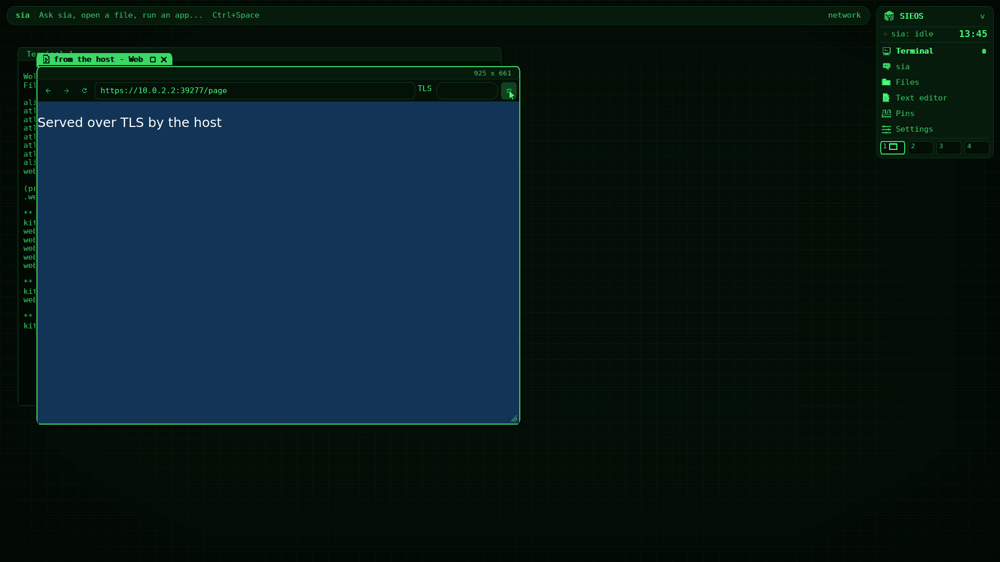

# The UI toolkit

`sieos/ui.h` is a small native toolkit for programs that open a window on
the desktop (`include/mk/atlas.h`): an application object and its loop, a
retained tree of widgets drawn in the desktop's theme, redrawn only where
something changed. It is written in C, about 2,000 lines in `user/lib/ui/`,
and works from C and C++, from programs built with SIEOS's own compiler and
library (`libui.a`) and from libposix programs (`libui-posix.a`). The web
browser's toolbar is made with it; `uidemo` shows every widget.



## Concepts

- **The application** (`ui_app_new`) is one window. `ui_root(app)` is a
  column filling it; widgets are made inside a parent and stay until
  `ui_destroy` (a retained tree, not an immediate-mode one). `ui_run` waits
  for the window's input, dispatches it and paints what changed, until
  `ui_quit` or the window is closed.
- **Layout**: boxes put their children in a row or a column (`ui_box(parent,
  UI_ROW or UI_COL, gap, padding)`). Each child gets the room it wants;
  what is left goes to children that stretch (`ui_set_stretch(w, share)`),
  and across, each child takes the box's whole height (or width).
  `ui_set_size` asks for at least a size. `ui_split` lets the user drag a
  divider between two children; `ui_tabs` shows one page at a time.
- **Sizes** are the desktop's picture pixels, the unit atlas lays out in (a
  button is 42 high), turned into the window's pixels by the desktop's
  zoom: at 200% everything is twice as big and the text is the 9 x 16 font
  drawn twice as large, sharp (HiDPI). Positions the program gets (events,
  `ui_bounds`, canvas pixels) are the window's own pixels.
- **Painting** is by damage: a widget that changes calls `ui_dirty` (the
  setters do), the rectangles are merged (at most 8), and `ui_flush` draws
  the tree clipped to each one, only the widgets they touch, then tells
  atlas which rectangles changed (`ATLAS_WIN_DAMAGE`). Overlays (menus,
  dialogs) are drawn over the tree.
- **The theme** comes from atlas (`ATLAS_WIN_THEME`): its palette as the
  current look shows it (Phosphor's greens, Amber's ambers, Glass's and
  BeOS's colours), its corners (square in Amber 1984, almost square in
  BeOS), its zoom and text size. When the user changes the look or the
  zoom, atlas sends `ATW_THEME` to every window: the toolkit fetches the
  theme again, lays out and repaints everything, then calls the program's
  `ui_on_theme`. The look's scanlines and glow are atlas's own and are not
  drawn by the toolkit: its widgets take the look's colours and corners.
- **Content keeps its colours.** Atlas shows a program's pixels exactly as
  drawn, in every look ([desktop.md](desktop.md)): the toolkit's widgets
  are drawn in the theme's colours, and a **canvas** (`ui_canvas`) holds
  pixels of the program's own, a web page or a document, never themed.
- **Input**: the pointer goes to the widget under it (the one pressed keeps
  it until the button is released); keys go to the widget with the keys
  (the focus: a click gives it, **Tab** and **Shift+Tab** move it among the
  widgets that take keys), then to its parents. Menu shortcuts come first
  (except a text field's own Ctrl+A, C, X, V). **F10** opens the menu bar.
  A canvas also gets Tab.
- **Another main loop**: a program that runs GLib's loop (the browser) has
  a thread wait for the window's input (`ui_wait`) and hands it to its own
  loop, which calls `ui_dispatch` and `ui_flush`.

## Building

A program built with SIEOS's own compiler links `$(B)/user/libui.a`
before `libsieos.a`; `user/lib/ui/ui.mk` has a rule for programs in
`user/NAME/NAME.c` (`$(eval $(call ui_prog,NAME))`, as `uidemo`). A
libposix program (C or C++) compiles with `-Iinclude` and links
`$(B)/web/libui-posix.a` (`make build/web/libui-posix.a`; `tests/ui/uicxx.cpp`
is a C++ example, `make build/web/uicxx`).

## An example

```c
#include "mk.h"                         /* (a libposix program: <stdio.h> ...) */
#include "sieos/ui.h"

static ui_widget *name, *hello;

static void greet(ui_widget *w, void *data)
{
    char t[96] = "Hello, ";
    (void)w; (void)data;
    strlcpy(t + 7, ui_text(name), sizeof t - 7);
    ui_set_text(hello, t);
}
static void quit(ui_widget *w, void *app) { (void)w; ui_quit(app, 0); }

int main(int argc, char **argv)
{
    ui_app *app = ui_app_new("Hello");
    if (!app) return 1;
    ui_widget *col = ui_box(ui_root(app), UI_COL, 10, 16);
    ui_widget *m = ui_menu(app, ui_menubar(col), "File");
    ui_item(m, "Quit", UI_CTRL('q'), quit, app);
    ui_label(col, "Your name:");
    name = ui_field(col, "", greet, 0);           /* Enter greets too */
    ui_widget *row = ui_box(col, UI_ROW, 10, 0);
    ui_button(row, "Greet", greet, 0);
    ui_button(row, "Quit", quit, app);
    hello = ui_label(col, "");
    (void)argc; (void)argv;
    return ui_run(app);
}
```

## The API

Every call is in `include/sieos/ui.h`. Callbacks are `void fn(ui_widget *w,
void *data)` (`ui_fn`), given with the widget or later with `ui_on`.

### The application

| Call | What it does |
|------|--------------|
| `ui_app_new(title)` | opens the window -> the application (0: no desktop, or not the user's) |
| `ui_root(app)` | the column filling the window |
| `ui_run(app)` | the loop, until `ui_quit(app, code)` or the window is closed -> the code |
| `ui_set_title(app, t)` | the window's title (its tab) |
| `ui_theme_of(app)` | the theme: `look`, `zoom`, `radius` and colours by role: `bg`, `panel`, `face`, `line`, `accent`, `ink` (text on the accent), `text`, `dim`, `field`, `sel`, `err`, `acctext`, `list`, `chosen` |
| `ui_on_theme(app, fn, d)`, `ui_on_close(app, fn, d)` | after a theme change (already restyled); the window was closed |
| `ui_scale(app, v)` | picture pixels -> the window's, at the zoom |
| `ui_clip_get(app, buf, cap)`, `ui_clip_set(app, s, n)` | the desktop's clipboard |
| `ui_wait(app, ev, max)`, `ui_dispatch(app, ev, n)`, `ui_flush(app)`, `ui_done(app)`, `ui_app_close(app)` | for another main loop: wait (any thread), hand out, paint; quit asked; close the window |
| `ui_fmt(d, s, v)` | `d` = `s` followed by `v` in decimal (programs without `printf` to a string) |

### Any widget

| Call | What it does |
|------|--------------|
| `ui_set_text(w, t)`, `ui_text(w)` | its text (a label's, a button's, a field's) |
| `ui_set_value(w, v)`, `ui_value(w)` | its value: check box and toggle 0 or 1; progress 0..1000 (-1: busy); tabs: the page; list: the chosen row (-1: none); scroll bar and split: the position |
| `ui_set_enabled(w, on)`, `ui_set_visible(w, on)` | greyed (no input), hidden (no room) |
| `ui_set_stretch(w, share)`, `ui_set_size(w, width, height)` | its share of the room to spare; at least this size |
| `ui_on(w, fn, d)` | its action: a click, a toggle, Enter, a double click |
| `ui_set_menu(w, menu)` | its right-click menu (also for its children) |
| `ui_focus(w)`, `ui_has_focus(w)` | give it the keys; has it |
| `ui_dirty(w)`, `ui_bounds(w, &x, &y, &w, &h)`, `ui_app_of(w)`, `ui_destroy(w)` | redraw it; where it is; its application; it and its children go |

### Layout

| Call | What it is |
|------|------------|
| `ui_box(parent, UI_ROW or UI_COL, gap, pad)` | children side by side or one under the other |
| `ui_split(parent, dir, pos)` | two children and a divider the user drags (`pos`: the first one's size) |
| `ui_tabs(parent)`, `ui_tab(tabs, title)` | pages, one shown, their titles on a row (click, or Left/Right with the keys); `ui_tab` returns the page (a column) |

### Widgets

| Call | What it is |
|------|------------|
| `ui_label(parent, text)` | text; `\n` starts a line |
| `ui_button(parent, text, fn, d)` | a pill like atlas's; Space or Enter when it has the keys |
| `ui_toggle(parent, text, on, fn, d)` | a button that stays in (value 1) |
| `ui_check(parent, text, on, fn, d)` | a check box |
| `ui_field(parent, text, fn, d)` | one line of text: the cursor (Left, Right, Home, End), a selection (drag, double click, Ctrl+A), Backspace, Delete, the clipboard (Ctrl+C, X, V); `fn` on Enter; `ui_field_select(w, from, to)` |
| `ui_progress(parent)` | a bar, 0..1000, or stripes for busy (-1) |
| `ui_scrollbar(parent, dir, fn, d)`, `ui_scroll_range(w, total, page)` | a scroll bar: drag the thumb, click the track for a page, the wheel |
| `ui_list(parent, ncol, titles, fn, d)` | rows and columns, a header, a scroll bar: rows from `ui_list_model(w, rows, cell, d)` (`cell(d, row, col)` gives each cell's text, asked only for rows shown: any number of rows); `ui_list_widths(w, chars)`; `ui_list_on_select(w, fn, d)` when the chosen row changes; `fn` on Enter or a double click; Up, Down, Page Up and Down, Home, End, the wheel |
| `ui_toolbar(parent)`, `ui_tool(bar, icon, text, fn, d)`, `ui_set_icon(tool, icon)` | a bar of flat buttons: an icon (`UI_ICON_BACK`, `FORWARD`, `RELOAD`, `STOP`, `MENU`, `PLUS`, `MINUS`) or text |
| `ui_canvas(parent, fn, d)` | the program's own pixels: `ui_canvas_pixels(w, &width, &height)` (0x00RRGGBB, `width` to a row), `ui_canvas_damage(w, x, y, width, height)` after drawing; `fn(w, event, d)` gets its input (x, y in it), focus, and `UI_EV_SIZE` when it changes size (new pixels: ask again). Never themed |

### Menus

| Call | What it is |
|------|------------|
| `ui_menubar(parent)` | a bar of menus (the first one opens with F10) |
| `ui_menu(app, bar, title)` | a menu in the bar, or (bar 0) a menu of its own for `ui_popup(menu, x, y)` or `ui_set_menu` |
| `ui_item(menu, text, key, fn, d)` | an item; `key` is its shortcut (`UI_CTRL('o')`, `UI_KEY_F1`...), shown on its right, working whenever no dialog is in front |
| `ui_separator(menu)` | a line between items |

In an open menu: Up and Down move, Left and Right go to the bar's next
menu, Enter picks, Escape closes; a click outside closes it.

### Dialogs

In the window, in front of everything, with the keys until answered
(Enter: OK, Escape: Cancel). `fn` gets the dialog: `ui_value` 1 for OK or
Yes, 0 for Cancel.

| Call | What it is |
|------|------------|
| `ui_message(app, title, text)` | text and OK |
| `ui_confirm(app, title, text, fn, d)` | a question: Yes, No |
| `ui_file_dialog(app, save, dir, name, fn, d)` | a file to open or save: the folder's entries from the file server (folders first, `..` to go up), a name; `ui_text` of the dialog is the chosen path |
| `ui_close_dialog(app)` | the front one, cancelled |

## Size

Measured with `size`: the toolkit's code and its font (the desktop's 9 x 16
font, 13.7 KB, and its 6 x 11 font, 0.9 KB, compiled from `user/atlas/`).

| Build | Code | With the fonts |
|-------|------|----------------|
| x86-64, gcc -Os (`libui.a`) | 26.6 KB | 41 KB |
| arm64, sicc -Os | 40.3 KB | 55 KB |
| libposix, clang -Os (`libui-posix.a`, before the linker drops what is unused) | 38.6 KB | 53 KB |

`uidemo`, every widget: 61 KB (x86-64), 82 KB (arm64). The browser grew
by 16 KB on arm64 (94,766,544 -> 94,782,928 bytes; 12 KB on x86-64) and lost its HTML toolbar page and the
second WebKit view that drew it.

## The programs

- **`uidemo`** (`user/uidemo/uidemo.c`, on the test disk): a menu bar
  (File: Open, Save as, Quit; Edit; View: progress, the list, the canvas;
  Help: About), a toolbar, three tabs (Widgets: label, buttons, toggle,
  check box, text field, progress bar and scroll bar, a question, a
  message, the file dialog; List: 500 rows beside a split, a right-click
  menu; Canvas: exact colours), a status line. `uidemo -v` says what
  happens on the serial console (for the test).
- **The web browser** (`user/web/browser.c`): a toolbar (back, forward,
  reload or stop, the address, TLS, the progress, a menu: open an address
  Ctrl+L, reload Ctrl+R or F5, stop, zoom in Ctrl+P, zoom out, actual
  size, quit Ctrl+Q; find in the page later) and the page in a canvas,
  WebKit's view drawn straight into its pixels (`sieos_toplevel_new_hosted`
  in `user/web/platform`), in its real colours.
- **Scriptures** (`user/scriptures/`) keeps its upstream core, which has
  its own widgets and draws atlas's looks itself (`draw.c`, `ui.c`). It
  could adopt the toolkit in two steps without touching that core: its
  platform layer (`plat_sieos.c`) asks for the theme (`ATLAS_WIN_THEME`)
  and follows `ATW_THEME` to set its look when the desktop's changes; then
  its dialogs and settings panels could be toolkit widgets around a canvas
  holding the text it lays out.






## Tests

`make ui-test` (`tools/uitest.py`, QEMU): exact colour patches
(`tests/ui/uipatch.c`) in every look; then `uidemo` drawn in BeOS's
colours, a click on a button, typing in the field (Enter, Ctrl+A), a menu
opened and used from the keyboard (F10, Right, Down, Enter) and a shortcut,
the file dialog opened and cancelled, the list (a click, arrows, its
right-click menu), the canvas's pixels exact in BeOS and in Phosphor while
the widgets restyled live, Quit. `make browser-test` checks the browser's
toolbar (the address with Ctrl+L, back, the menu's zoom and its shortcut)
in the look's colours and the pages in their own.

## Limits

One window per application; text in printable ASCII (the desktop's
fonts); no timers (a program that animates runs its own loop with
`ui_wait` from a thread); the looks' scanlines and glow are not drawn on
widgets.
